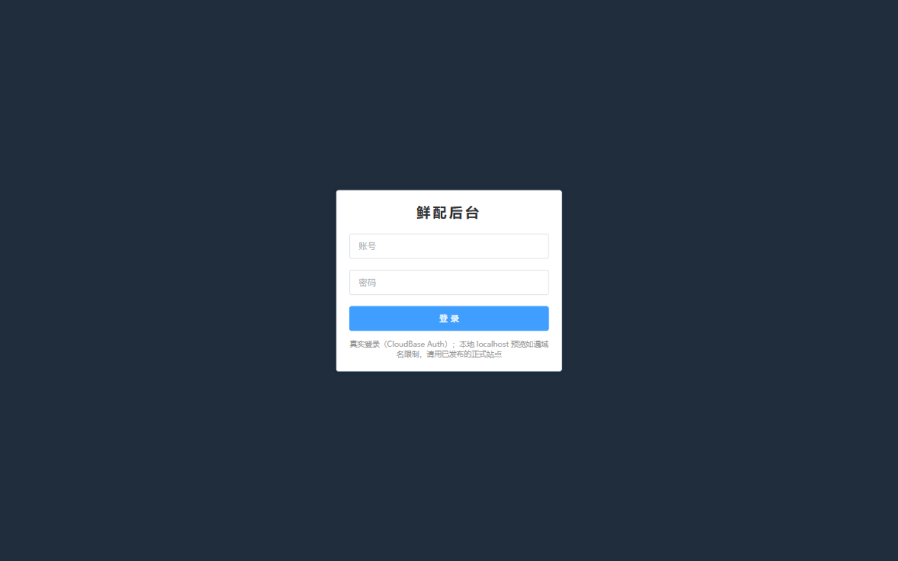
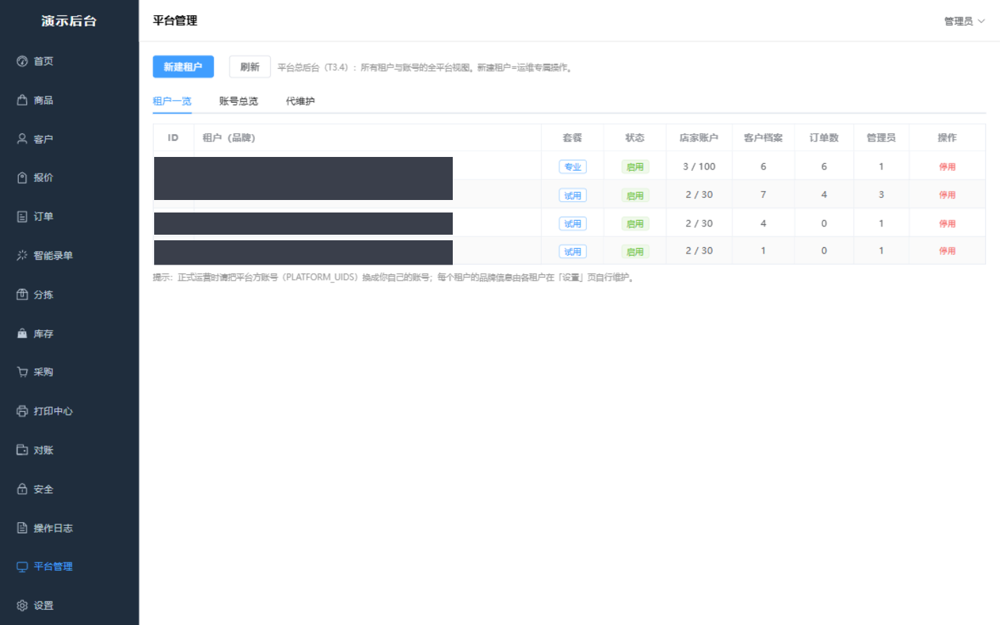
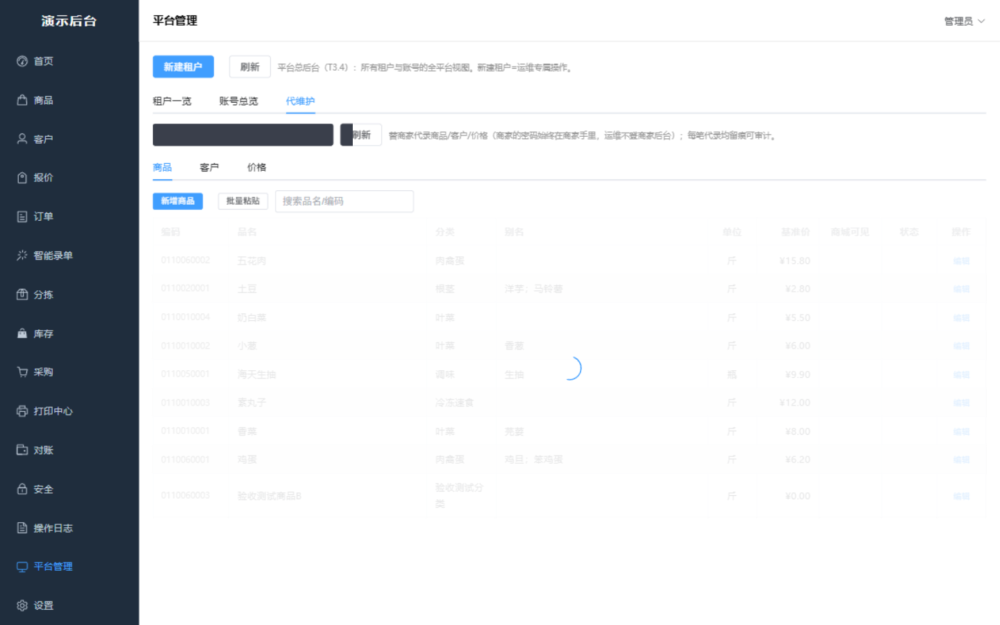
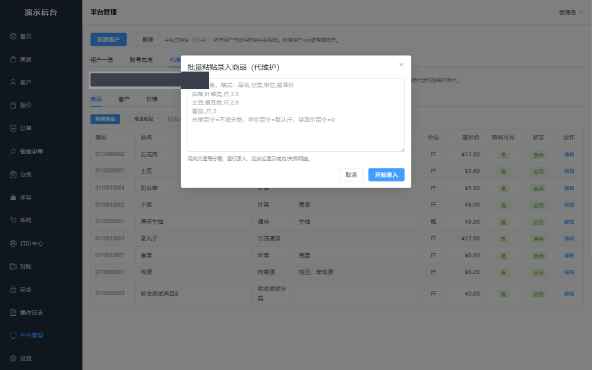
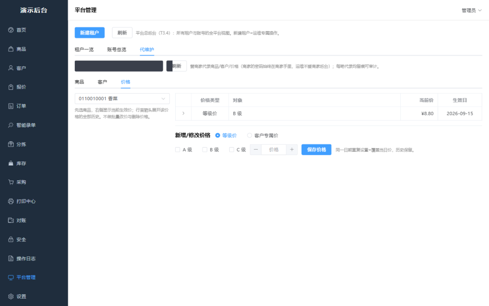
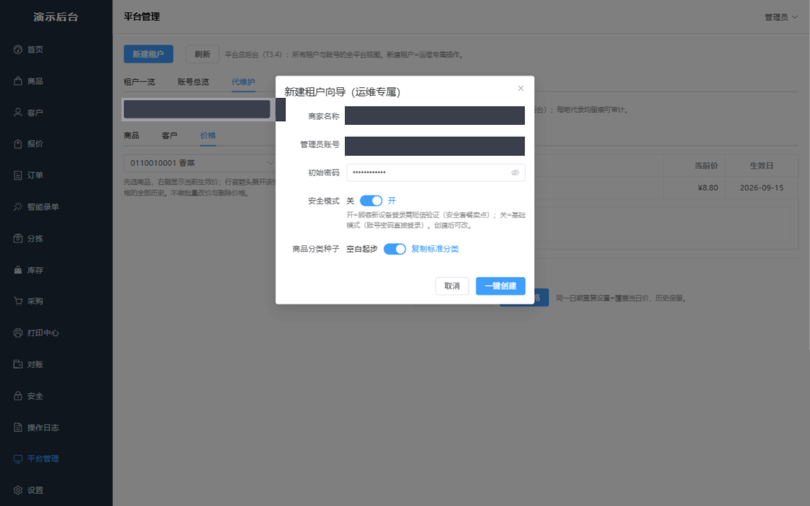

# FreshFlow · 生鲜蔬菜 B2B 订货配送平台

> 一套面向蔬菜批发商的多租户 SaaS：餐饮店家通过**小程序 / H5 商城**下单（支持 AI 识图、语音开单），批发商在**管理后台**完成报价、分拣、配送、对账、打印，全流程数字化。

    

**开发周期 8 天 · 60 commits · 前后端+小程序+云函数全栈单人交付（人机协作工作流）**

---

## 这是什么

传统蔬菜批发每天靠微信接单、手抄订单、电话对账。FreshFlow 把这条链路完整搬上线：

```
餐饮店家                        批发商（平台运营方）
   │                                │
   ├─ 小程序：下单/语音开单/查账      ├─ 管理后台：商品/报价/订单/分拣
   ├─ H5 商城：免安装同功能           ├─ 分拣屏：逐行实拣/缺货登记
   └─ 拍手写订单照片 → AI 识别        ├─ 打印中心：小票/配货单/出库单
        │                           ├─ 对账：应收/实收/欠款/月结
        └── 云函数 ai（GLM-4.5V 识图）─┴─ PostgreSQL（RLS 多租户强制隔离）
```

## 核心功能

| 模块 | 说明 |
|---|---|
| **五种下单方式** | 商城点单 / 批量粘贴 / 草单并单 / **拍照 AI 识别** / **按住说话语音开单** |
| **AI 识图开单** | 手写订单照片 → GLM-4.5V 结构化识别 → 词库校验 → 低置信标红人核。A/B 实测从 DeepSeek 切换 GLM 后潦草字样识别 4/4 全对（详见 `ai/test/识别率实测报告.md`） |
| **语音开单** | 「香菜两斤土豆五斤」→ 录音 → 腾讯云一句话识别（手写 TC3 签名，零 SDK 依赖）→ LLM 结构化 → 确认下单 |
| **多租户隔离** | PostgreSQL RLS 行级安全 26+2 条策略，商家/顾客/平台三层隔离，跨租户读写实测 403 |
| **报价体系** | 基准价 + A/B/C 等级价 + 客户单独价，生效日历史留痕，同日重复设置自动覆盖 |
| **订单状态机** | draft → confirmed → sorting → ready → shipped → done（+void），实拣量自动替换下单量定价 |
| **账期与对账** | 当日结/月结/货到付款，欠款上限、超期禁单、payment_ledger 应收实收台账 |
| **打印三件套** | 80mm 药店小票 / A4 配货单 / A4 出库单，模板即 HTML，浏览器直接打印 |
| **安全体系** | 新设备短信验证 + 商家白名单放行、90 分钟会话保活、操作日志全留痕（人话摘要）、账号四层权限 |
| **白牌 SaaS** | 租户级品牌定制，新建租户向导一键开店（租户+管理员+分类种子一次建成） |

## 部分界面

| 登录 | 多租户一览 |
|---|---|
|  |  |
| **代维护-商品面板** | **批量粘贴录入** |
|  |  |
| **等级价设置（历史留痕）** | **新建租户向导** |
|  |  |

（演示数据）

## 技术要点与踩坑沉淀

开发全程留有[开发日志](docs/开发日志.md)（15 条事故复盘）与[开发手册](docs/开发手册.md)（21 条坑清单），摘几条有意思的：

- **RLS 是底线不是装饰**：前端门禁只算展示层，顾客 token 裸打 REST、商家跨租户写库全部被 RLS 拒绝——三层隔离用五组对抗性实测验证过。
- **access_token 2h 过期引发的"保存假成功"**：js-sdk 静默失败 0 行，用户看到 toast 成功但库里没有。根治 = 会话保活 + 写后回读比对 + `.select()` 0 行守卫 + `unhandledrejection` 全局兜底，全系统零静默失败收口。
- **腾讯云 TC3 签名手写实现**：云函数不引 SDK（控制包体积），按官方规范手写 TC3，踩掉 canonicalHeaders 尾换行的坑。
- **AI 选型靠实测不靠宣传**：qwen-vl-plus 行号幻觉、qwen3.5-ocr 不守 JSON、DeepSeek 潦草字臆造——A/B 对比后 GLM-4.5V 胜出，双 Key 双通道分离部署（image/text/audio）。
- **外部用户不限量的架构红利**：CloudBase Auth `internalUser` 占配额、`externalUser` 不限量——商家/员工用内部名额，终端店家无限开号，僵尸号零成本。
- **中文编码三连坑**：Git Bash curl 发中文 GBK 乱码、测试脚本中文参数污染数据库、argv 传中文乱码——沉淀为「凡测试体含中文必须写文件+校验编码」的纪律。

## 目录结构

```
├── web-admin/        管理后台（Vue3 + ElementPlus，14 页）
├── web-mall/         H5 商城（单文件 SPA，与小程序同网关 API）
├── miniprogram/      微信小程序（下单/语音开单/订单/地址簿）
├── cloudfunctions/   云函数（ai：识图/语音/文本三通道 + useradmin + platform + authgate）
├── database/         schema.sql + 全部 migrations（本地为结构真源）
├── print/            打印三件套模板（80mm 小票 / A4 配货 / A4 出库）
├── ai/               AI 提示词与识别率实测（A/B 报告）
├── tools/            部署脚本 / 文档生成 / 打印代理
└── docs/             开发日志 / 开发手册 / 运维手册 / DB 速查卡 / 需求与任务书
```

## 说明

本仓库为个人技术作品展示。
- 平台后端依赖腾讯云 CloudBase（Auth 网关 / 云函数 / PostgreSQL），演示环境未部署，代码与文档供阅读。
- 数据库表结构见 `database/schema.sql`，订单状态机与金额口径见 `docs/STATE_AND_AMOUNT.md`。
